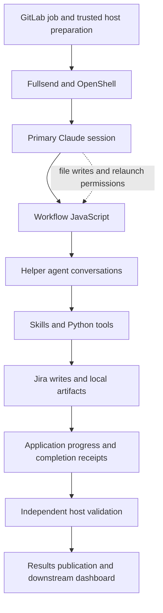

# Migrating Bash orchestration to Claude dynamic workflows

Draft retrospective, 2026-10-28. Project: [AISDLC-52](https://redhat.atlassian.net/browse/AISDLC-52).

The main lesson for this migration is that resilience became an application
architecture project. JavaScript expressed the schedule; additional code had
to establish what ran, what was received, what changed, what could safely be
reused, and what the host was entitled to publish.

Moving strat-creator from Bash-orchestrated Claude batches to dynamic workflows
required substantially more than translating a loop. The resulting
implementation handles full fresh and mixed batches in the tested
configurations, with Python helpers, explicit state, hooks, independent host
validation, and recovery protocols around a small JavaScript coordinator.

[Decision makers](#for-decision-makers) can read how the direction was set, the
observed execution change, the false-confidence risk, implementation effort,
rollout status, the recommendation for other teams, and version limits first.
[Engineers](#for-engineers) can then follow the changed execution boundaries,
resilience mechanisms, validation evidence, and migration sequence.

## For decision makers

### How the workflow direction was set

The project's ADR for a custom script entrypoint in Fullsend,
[#7947](https://github.com/fullsend-ai/fullsend/pull/7947), was reviewed from October 1 to 13, 2026:

| Date | Event |
| --- | --- |
| October 6 | Maintainer `waynesun09` [requested changes](https://github.com/fullsend-ai/fullsend/pull/7947#pullrequestreview-5432894717), including weighing runtime-native workflows as an option because they keep the runner's per-tool-call hooks, status and usage. |
| October 8, 17:00Z | A different maintainer, `ralphbean`, [approved](https://github.com/fullsend-ai/fullsend/pull/7947#pullrequestreview-5460180264) the revised ADR. |
| October 8, 21:15Z | `waynesun09` [recommended rejecting](https://github.com/fullsend-ai/fullsend/pull/7947#pullrequestreview-5462939711) `entrypoint:` and replacing it with an ADR for workflow-definition repositories as harness resources. |
| October 9 | `waynesun09` opened the replacement, [ADR 0130](https://github.com/fullsend-ai/fullsend/pull/8225). |
| October 13 | `ralphbean`, who had approved it, [closed #7947 unmerged](https://github.com/fullsend-ai/fullsend/pull/7947#issuecomment-6153432606) after a Slack discussion: "Let's head in the direction proposed by @waynesun09." |

The recommendation's stated reasons were that an entrypoint leaves the runner
with no complete token, cost or turn metrics and with hooks only for children
launched through a helper; that the entrypoint proof of concept re-implemented
about 970 of its 2,874 lines to regain runner features; and that an entrypoint
still runs as one bounded job, so it did not address multi-hour batches. It
named three acceptable agent-led shapes (skill-guided, prompt-guided, and an
orchestration script behind a thin trigger prompt) and placed strat-creator on
the Claude workflow because its Skills are Claude-specific. The evidence cited
for that port was a passing headless smoke run.

As of October 28, Fullsend has no merged record of the decision. ADR 0130 is
open; its file is marked Accepted, and its implementation PRs
([#8226](https://github.com/fullsend-ai/fullsend/pull/8226), [#8228](https://github.com/fullsend-ai/fullsend/pull/8228)) are unmerged. It records the script
entrypoint as rejected because the runner sees only the script's exit code and
stdout. When implemented, it pins the workflow by commit and tree hash, scans
it, and has the runner start it. It adds no tool or hook surface, so it does
not stop the session from editing the delivered copy or launching another
execution, and it does not move external writes to the host. Its
validation-loop retry reruns the same command and relies on the workflow's
own durable state to skip finished work. Until it lands, consumers vendor the
workflow from a host pre-script, which is what strat-creator does.

Neither the review nor ADR 0130 weighed the coordinator-control trade-off
described in the next section.

### The agent changed the Workflow during a failed run

On October 14–15, an Opus batch encountered Anthropic tool-schema rejection.
The surrounding primary agent stayed active and tried to repair the failure.
The archived transcript and journals show this sequence:

1. It launched the named Workflow, which failed on the schema.
2. It removed top-level `oneOf` constraints from both Workflow source copies.
3. It recomputed source hashes in the prepared input and replaced the progress
   freshness baseline.
4. It launched the named Workflow again; the cached original code failed again.
5. It launched the edited source through `scriptPath`; that execution completed
   and wrote a locally successful receipt.

One submitted job therefore contained **three Workflow executions** and took
about 73 minutes. The trusted host rejected the changed baseline, so the job
failed despite the local receipt and three published strategies/reviews.
[Full incident and chronology](../bugs/open/s1-primary-edits-source-and-freshness-after-failure.md).

The feature is called **dynamic workflows**, not “deterministic workflows.”
Anthropic describes Claude generating orchestration scripts for a task and
running agents through them. A fixed script can provide predictable scheduling
while the surrounding agent remains able to change files and launch different
executions. This migration observed that behavior directly.
[Anthropic introduction](https://claude.com/resources/articles/introducing-dynamic-workflows-in-claude-code),
[official cookbook](https://platform.claude.com/cookbook/claude-agent-sdk-08-dynamic-workflows).

The agent can and, in this observed run, did modify its orchestration to pursue
the assigned goal. This was a response to failure, not a maintainer-reviewed
repair deployed between runs. The recorded behavior includes editing source
and relaunching; it does not establish hot-patching the JavaScript already
executing inside an existing VM.

Calling the JavaScript deterministic does not account for that surrounding
control path. Hashes and checks implemented in files the same agent can edit
are useful recovery machinery, but they cannot establish an immutable execution
boundary. Host validation protected final acceptance here; it did not prevent
the changed execution, repeated inference, or earlier Jira side effects.
Equivalent write and relaunch permissions can expose a Bash-based agent setup
too. The relevant difference from the original external coordinator is whether
the worker can replace and restart the coordinator it is supposed to obey.

A controlled production run consequently needs a decision about source
immutability, trusted baselines, permitted launches, and termination after
definitive failure. Enforcement belongs outside the worker's writable state.
The ledger still tracks that source/baseline protection gap as open. Moving
hooks into an equally writable plugin directory does not close it, and a raw
Jira credential can authorize writes outside the helper protocol. A host-only
writer was assessed as an architectural option, not implemented as part of
the migration's agreed incremental scope.
[Security assessment and reproduced limits](strat-pr85-stoyan-security-review-20261022.md),
[scope comparison with rfe-autofixer](../tasks/done/strat-security-rfe-autofixer-baseline.md).

### The most serious risk was false confidence

Before hardening, a run could publish a strategy as reviewed while the
intended specialist assessments had never reached the final review. Readers
downstream would see ordinary documents, comments and approval labels, with
nothing showing that the process behind them was incomplete. That failure is
silent: it does not raise an error or cost noticeably more, so token totals and
exit codes do not reveal it. Much of the hardening exists to make it visible.
[Hardening record](../plans/strat-workflow-s1-hardening.md#2026-10-18-migration-verdict-and-why-the-testing-mattered).

### The size and cost of the work

The merged strat-creator migration at `b295fe9`, compared with its parent
`bb4887b`, spans **164 changed files, 17,156 insertions, and 351 deletions**.
The main Workflow is **322 lines**, with a bundled plugin copy of the same
length. The complete diff includes helpers, host integration, hooks, tests,
fixtures, documentation, and bundled duplicates. It is a measure of this
migration's scope, not 17,156 unique lines of resilience logic or a minimum
every workflow needs.
[Merged change](https://github.com/fullsend-ai/strat-creator/pull/85).

The October 18 usage audit recovered **478,893,465 reported tokens**, plus
about ten million from a rounded early summary: approximately **489 million**
through that accounting cutoff. About 94.8% of the exact total was cache
creation/read input. That is repeated accounted usage, not unique source text
or one context window. It excludes development conversations, labor,
infrastructure, later integration/review work, and unrecovered usage.

The audit's historical estimate was about **$485 in API-equivalent cost** with
GLM priced at zero. It was not an invoice reconciliation or the total cost
of the project. Later GitLab runs alone added roughly 29, 30, and 47 minutes
of job runtime for the single smoke, scheduled failure, and post-fix batch.
The records do not support a complete person-hour or October 28 token total.
They also do not measure the recurring cost: ownership of the Workflow, its
Python helpers and hooks, and requalification on each Claude Code release.
For a team deciding whether to migrate, that ongoing cost is a missing input,
not a known quantity.
[Dated accounting and method](strat-workflow-total-token-usage-20261018.md).

Some expense was necessary to expose interactions that small tests could not:
shared batch scope, full-size hooks, mixed recovery, provider compatibility,
and actual sandbox/publication behavior. Some was avoidable. Earlier local
schema checks, realistic hook profiling, archived-report replay, and stronger
model/transport preflight would have reduced paid debugging. A failed run's
entire spend should not automatically be counted as an inherent workflow cost.

Observability itself was work. The investigation used native state and journals,
receiving-agent messages, transcripts, API captures, syscall traces, Jira
snapshots, and checksummed host archives. Later remote GitLab runs did not
have every local capture configured. Console heartbeats could hide long inner
phases; a post-run transcript reconstruction was needed to explain the quiet
interval. A log saying an agent ran is weaker than evidence of what its
recipient received and what Jira retained.
[Archive work](../tasks/done/strat-workflow-run-data-archives.md),
[remote reconstruction and capture limits](../tasks/done/strat-postmerge-single-smoke-20261027.md#reconstruction-of-the-quiet-console-interval).

### Status and remaining questions

The main Workflow migration and GitLab opt-in support are merged:
https://github.com/fullsend-ai/strat-creator/pull/85 and
https://gitlab.com/redhat/rhel-ai/agentic-ci/strat-pipeline/-/merge_requests/18.
The placeholder fix is merged. Scheduled execution is back on legacy; batch
isolation and its review follow-up remain under qualification.

The tested Workflow offers useful scheduling and separate agent contexts.
The evidence does not establish a general simplicity, cost, or reliability
advantage over external scripts. Functional batch success also does not settle
independent strategy quality, a production failure rate, immutable execution,
or distributed ownership. Those are separate claims with separate acceptance
criteria.

### Recommendation for other teams

Start with one question: as deployed, is your current coordinator actually
outside the worker's writable state? The answer decides whether a migration
would give up a boundary or merely keep a gap you already have.

Do not migrate a working script- or SDK-driven production pipeline to a
dynamic workflow by default. The evidence here does not show a benefit that
pays for the additional orchestration boundaries and qualification work:

- **Control of the running outer loop.** In the scripted design, Bash runs
  the outer loop and Claude is a worker it invokes. Editing a file does not
  hot-reload that already parsed loop; replacing it requires an explicit
  reload or re-execution. In the observed Workflow incident, the surrounding
  primary Claude session could edit the Workflow and launch another execution
  within the same job. This was edit-and-relaunch, not hot-patching a running
  VM. That control difference does not establish that the old script's source
  was read-only. Source permissions, trusted baselines, and launch policy need
  explicit enforcement in either architecture.
- **Direct mechanics.** Deterministic helpers become agent-mediated tool calls
  with relayed results. Each relay adds a boundary to validate. In the
  historical three-RFE Opus Workflow run, only 2 of 12 specialist assessments
  reached the receiving agent through the intended Skill result; ten returned
  acknowledgements instead. This is the handoff-loss comparison, separate from
  the later self-modification incident.
  [Handoff diagnosis](../../scripts/claude_binary_analysis/docs/claude-code-2.1.296-workflow-specialist-handoff.md#what-this-explains-in-the-real-runs).
- **Resilience it does not supply.** Write-once effects, freshness and
  independent completion are still application code, now also covering agent
  handoffs and native replay.
- **Version stability.** Runtime behavior was characterized on one pinned
  release and must be requalified on upgrade.

The observed advantage, overlap of stages, is available to scripts too.
Historical Opus evidence includes three successful single-RFE runs per design
and one completed three-RFE batch per design. The singles experienced unequal
transport failures; the completed batches used overlapping Workflow stages
versus sequential scripted stages. These small, confounded samples do not
establish equivalent performance or a general cost ranking. Hardened runs
have recorded usage and cost estimates, but no controlled comparison against
an equivalent scripted implementation establishes a hardened per-run cost
difference.
[Evaluation record](../plans/strat-workflow-eval-plan.md),
[completed batch comparison](../../var/benchmarks/strat-workflow/analysis.md#11-the-workflow-finished-sooner).

A dynamic workflow is reasonable when:

- the platform steers toward it. Here, Fullsend closed the custom-entrypoint
  ADR in favor of a reviewer's proposal that named a workflow as one of three
  agent-led shapes (see [how the direction was set](#how-the-workflow-direction-was-set));
  that does not establish that Fullsend requires workflows in general. Budget
  for the hardening and ask the platform for a host-supplied read-only script,
  launch policy and host-side writes. Those are platform changes; the
  workflow's own repository cannot supply them, and ADR 0130 as proposed
  covers only pinned, scanned delivery and a runner-started launch;
- the task is exploratory or one-off (audits, research, code migrations,
  reviews), where generating the orchestration is the point;
- external effects are idempotent or absent, and a person or trusted host
  validates output before publication; or
- the work is new and the deterministic parts stay in ordinary code, with the
  workflow only scheduling.

Teams that migrate anyway should follow the
[sequence for the next migration](#a-practical-sequence-for-the-next-migration)
and treat two items as entry conditions: keep the workflow source, baselines
and launch policy outside the worker's writable state, and route external
writes through host-side code or an intent-then-readback protocol.

This note evaluates the Workflow architecture and its Fullsend integration. It
does not compare runner platforms (support model, upgrade cadence, lock-in,
exit cost, or who owns runtime fixes); that choice needs its own evaluation.

In short, dynamic workflows suit orchestration that has to be improvised. For
an established production process, this migration demonstrated substantial
additional engineering without establishing a compensating advantage over
external orchestration.

### Runtime versions and revalidation

The runtime analysis, native controls, and detailed handoff/replay findings in
this retrospective were verified against **Claude Code 2.1.296**. They have
**not been revalidated on 2.1.311 or later** in the investigation records cited
here. The [Workflow Dojo record](../plans/workflow-dojo-plan.md) documents
2.1.311 and a successful one-agent `hello-workflow` smoke. That demonstrates
basic Workflow execution on the newer version; it does not repeat the schema
inheritance, Skill serialization, replay, retry, hook-timeout, or completion
fault controls.

Before using one of those runtime findings to choose a current architecture
or workaround, rerun its focused control against the target binary and record
the version/hash and outcome. The October incidents and migration effort remain
historical evidence; whether a newer runtime retains each behavior is an open
validation question. A newer installed version alone does not close the
application's source-protection, external-write, or ownership requirements.
[Versioned investigation index](../../scripts/claude_binary_analysis/docs/README.md).

## For engineers

### The migration changed who controls execution

The original production shape was an external script coordinating create,
refine, push, and review through Claude invocations and existing helpers.
Bash chose the next command and consumed its process output and status. The
model still performed nondeterministic work inside each invocation, but the
outer orchestration did not need the model to decide to run its next shell
command or relay that command's JSON faithfully.

The native Workflow instead runs JavaScript inside Claude Code and creates
helper agents through `agent()`. Those agents choose tool calls and return
text or structured results. The primary conversation launches the Workflow
asynchronously and later receives its outcome. Fullsend adds the runtime,
sandbox, policy, provider configuration, and host pre/post processing around
that session.

The historical S1/S2 benchmarks compared native Workflow orchestration with a
scripted entrypoint. They were followed by native Workflow hardening after
custom entrypoints were rejected for the production direction
([how the direction was set](#how-the-workflow-direction-was-set)). That history
matters: some work was architectural comparison, some was application repair,
and some was integrating the selected architecture into Fullsend and GitLab.
They are different sources of effort.
[Evaluation plan](../plans/strat-workflow-eval-plan.md),
[hardening plan](../plans/strat-workflow-s1-hardening.md),
[earlier scripted POC](../plans/fullsend-entrypoint-strategy-poc.md).

### JavaScript becomes an operational dependency

Maintainers now need enough JavaScript to review async functions, promises,
exceptions, fan-out, result composition, and partial failure. Having Claude
write the script does not remove the need to understand what production runs.
The existing Bash and Python skills remain necessary for the helpers, hooks,
CI jobs, and deployment adapters.

This learning cost was concrete: Workflow Dojo added a JavaScript tier for
Python developers after JavaScript semantics repeatedly cost the maintainer
time. Its exercises cover returns, truthiness, sorting, scope, collections,
callbacks, and async behavior before the production orchestration patterns.
Four of those patterns are drawn from this retrospective: freshness keys that
cover every input, intent recorded before an external write, per-item deferral
instead of batch failure, and completion decided from an artifact inventory.
They exercise the recovery rules in a simulator; they are not evidence about
the Claude runtime.
[Dojo training record](../plans/workflow-dojo-plan.md).

The tested Claude Code 2.1.296 runtime is also a restricted JavaScript
environment, rather than a general Node application. It provides orchestration
helpers such as `agent`, `parallel`, and `pipeline`; ordinary filesystem,
module-loading, and subprocess APIs are unavailable to the script. In this
runtime, invoking a mechanical helper requires an agent to emit the tool call.
A request to run a deterministic Python command therefore adds model-mediated
invocation and result-transfer boundaries that an external Bash call avoids.

Error semantics need explicit handling too. The tested `parallel()` can turn
rejected branches into `null`, and a `pipeline()` item reaching `null` skips
later stages. The application must decide whether that means a deferred
ticket, a failed ticket, or a failed batch. Phase labels describe progress;
they do not impose barriers. These are findings for the pinned runtime, not
claims about every later Claude release.
[Runtime analysis and controls](../../scripts/claude_binary_analysis/docs/claude-code-2.1.296-workflow-analysis.md).

### What had to be added around the Workflow

| Responsibility | Failure exposed during migration | Additional implementation | Workflow-specific? |
| --- | --- | --- | --- |
| Delivering reviewer results | A specialist finished, but the receiving agent got an acknowledgement instead of the assessment | Explicit reviewer agent configuration, tool isolation, capture of actual returned content, and delivery checks | No: an agent/schema defect that also reproduced in a plain CLI control |
| Keeping ticket scope | Reviewers assessed the whole batch despite an individual assignment | Exact target binding, constrained reads, scope hooks, and target validation | No: affected both designs in the comparison |
| Reconciling progress | Refinement was saved, but malformed returned JSON excluded it from review | Durable state, target-bound receipts, and readiness reconciliation against actual artifacts | Partly: the relay through structured output is new; durable progress is general |
| Preserving review evidence | A final narrative could lose findings or dissent | Persisted source reports, provenance hashes, mechanical composition, and independent verification | No: any agent-composed review needs it |
| Establishing completion | CLI exit, native Workflow state, and business work disagreed | Completion receipts, journal inspection, artifact checks, and host validation | Partly: the extra runtime state is new; independent completion is general |
| Recovering external writes | A write committed before the caller recorded success | Durable mutation intent, exact remote readback, operation identity, and refusal of ambiguous retries | Partly: native replay adds a path; write-once recovery is general |
| Reusing saved work | Cached results survived changes to files and instructions | Source/context/input baselines and explicit freshness checks | Partly: native replay reuse is new; freshness is general |
| Enforcing checks within time limits | Hooks timed out, first allowing continuation and later blocking valid work | Blocking failure configuration, separate heavy checks, and full-size profiling | Partly: hook-based enforcement inside the agent session |
| Handling one changed ticket | One stale RFE blocked five unchanged tickets | Per-ticket deferral, independent host accounting, filtered publication, and recovery evidence | No: batch isolation is general |
| Deploying the selected path | A local pass did not prove sandbox, GitLab, or downstream compatibility | Harness materialization, provider/egress setup, CI parity tests, artifact export, and real runner qualification | Partly: specific to the Fullsend path, not to Workflow scheduling |

These responsibilities are not universally unique to workflows. Bash also
needs idempotence, ownership, and freshness for safe recovery. The specific
additional burden here came from relocating control and adding agent-mediated
handoffs, replay, concurrent work, and multiple completion states. A Bash
orchestrator did not require a model to repeat its helper command's output
through `StructuredOutput` before it could decide which ticket was ready.

#### Completed work and returned work became separate questions

In the completed historical three-RFE Opus comparison, ten of twelve native
Workflow specialist returns lost the substantive assessment at the expected
Skill boundary. The diagnosis reproduced schema-tool inheritance into nested
Skill forks: a final tool-only response passed through a text-only return
projection and lost earlier content. The repair selected an explicit reviewer
agent whose tools excluded `StructuredOutput`, while preserving the receiving
agent's outer schema.

That failure also occurred in a plain CLI control using a schema; it is not
exclusive to Workflow scheduling. The migration exposed the combination.
Likewise, whole-batch reviewer scope affected both designs in the historical
comparison. The lesson is to verify the effective tools and actual receiving
messages, rather than attribute every defect to the workflow engine.
[Delivery repair](s1-hardening-01-reviewer-delivery.md),
[scope repair](s1-hardening-02-reviewer-scope.md),
[native handoff diagnosis](../../scripts/claude_binary_analysis/docs/claude-code-2.1.296-workflow-specialist-handoff.md).

A different failure saved a completed refinement but returned nested JSON
inside a string field. A shape-valid response still failed the exact ticket-key
comparison. The repair introduced a checkpoint that compares claimed readiness
with current-run progress and artifacts. That added another agent boundary,
another structured result, and a hook to validate it.
[Refinement receipt repair](s1-hardening-03-refine-receipts.md).

The final review also required a separate evidence contract. Stored specialist
reports are composed with attribution and dissent preserved. Numeric scores
remain the chosen approval gate; an approved strategy can still contain a
specialist's recommendation to revise. A final “approve” is not evidence that
all specialists agreed.
[Composition contract](s1-hardening-04-review-composition.md).

#### One success signal was no longer sufficient

The controls observed failed or killed Workflows alongside successful outer
CLI signals, and completed Workflows followed by failures in the notification
turn. A failed notification must not cause already completed Jira work to run
again. Conversely, a zero exit from the primary conversation cannot promote
missing business work to success.

The implementation therefore tracks business completion, native runtime state,
and CLI/reporting outcome separately. A hashed completion receipt accounts for
the acquired inventory, required phases, artifacts, provenance, and decisions.
The host verifies it using trusted code and its own prepared state. Reporting
recovery restores verified results rather than regenerating strategies.
[Outcome contract](s1-hardening-06-final-outcome.md),
[runtime operations controls](../../scripts/claude_binary_analysis/docs/claude-code-2.1.296-workflow-operations.md).

#### Recovery required a second durable record

The Workflow journal records agent results. It does not make Jira mutations
exactly once. Native controls killed an agent after a side effect but before
result journaling; replay repeated that effect. Retry exhaustion and stall
recovery also restarted agent conversations and repeated fixture effects.
Request retries and restarting an agent are different operations.

The repair writes and fsyncs mutation intent before an external write, then
reconciles exact remote state before repeating anything. Clone/link recovery,
comment ADF, attachment bytes, fields, labels, owner release, and result
publication each need operation identity and recovery rules. A pending write
with no visible match stops for reconciliation because an absent search result
does not prove the first request never committed.

Publication uses a stable run identity and immutable manifest. Atomic local
writes and copies prevent interrupted files from poisoning later recovery.
These mechanisms are application code that native replay did not supply.
[Recovery contract and fault matrix](s1-hardening-07-recovery.md),
[partial summary writes](../bugs/fixed/strat-review-summary-partial-write.md),
[interrupted publication copies](../bugs/fixed/strat-publication-mid-copy.md).

#### Freshness became a detailed policy

Native replay controls reused a journaled result after files, project
instructions, and discovered Skills changed. Application freshness therefore
binds work to source, instructions, architecture, run parameters, RFE inputs,
SME context, and publication state. The hardened S1 path uses fresh Workflow
launches with application progress and refuses native replay that could bypass
those checks.

That policy must distinguish genuine input changes from the pipeline's own
bookkeeping and harmless representation changes. Jira Markdown/ADF round trips,
empty templates, optional prior reviews, title cleanup, and attachment fallback
all needed explicit treatment. One interrupted import could leave a stale
optional review on disk even though the new inventory omitted it; freshness
alone did not detect that mismatch. Recovery now stops on ambiguous leftovers.
[Freshness contract](s1-hardening-08-freshness.md),
[optional context defect](../bugs/fixed/strat-import-stale-optional-context.md),
[round-trip fingerprint defect](../bugs/fixed/strat-review-only-roundtrip-fingerprint.md).

Human approval and ownership also require rechecking at mutation boundaries.
A human-sign-off added after preparation must stop writes. Run owner labels
and local locks improve recovery, but Jira labels do not provide an atomic
distributed lease or fencing across independent hosts.
[Late human gates](../bugs/fixed/strat-late-human-gate-writes.md),
[distributed ownership limitation](../bugs/open/strat-jira-label-locks-not-atomic.md).

#### The enforcement code became a performance problem

Initially, critical hooks timed out at ten seconds and the Workflow continued.
The repair made the relevant tool hooks block on failure and moved live Jira
verification out of their short execution window. Later, those blocking hooks
correctly failed valid work because local verification itself exceeded the
deadline.

The refinement checkpoint repeatedly scanned 453 source files and 1,846
architecture files. A full-size mechanical replay reproduced the timeout;
removing duplicate verification and improving traversal made the traced hook
fit under the same limit. At ten tickets, final completion repeated full
freshness verification twelve times. Its matched traced measurement fell from
20.423 seconds to 2.465 seconds after verifying once per invocation. The policy
and timeout stayed intact.

This is a concrete cost of adding resilience: the guard can become the failure
mode. Small unit fixtures did not represent the deployed tree or full batch.
[Fail-open timeout](../bugs/fixed/strat-structured-output-hooks-timeout-fail-open.md),
[refinement profiling](../bugs/fixed/strat-refine-checkpoint-hook-timeout.md),
[ten-ticket completion profiling](../bugs/fixed/strat-completion-hook-ten-ticket-timeout.md).

### Fullsend integration added a separate qualification layer

A passing Workflow in a Breadboard/Markov Kubernetes benchmark did not prove
the Fullsend/OpenShell execution boundary. Integration required host discovery
and owned locking, verified source materialization, plugin/hook registration,
model/provider configuration, current architecture fetching, preflight, egress,
CA trust, artifact transfer, validation, publication, and cleanup.

One example of hidden packaging work: the tested Fullsend 0.47.1 registration
could not resolve every needed companion from a registration alone. Shared
setup materialized verified companions into private runtime state. Simplifying
the pipeline repository from fifteen changed files to five moved reusable
implementation into strat-creator; it did not remove that implementation.
[Consumer simplification](../tasks/done/strat-pipeline-minimal-fullsend-consumer.md).

The migration also had to preserve all four operator paths: JQL batch,
configuration batch, single RFE, and explicit STRAT reprocessing. Resume is
not automatically equivalent to deliberate reprocessing of approved work.
GitLab rules had to select exactly one executor family, preserve batch
serialization and cleanup, and prevent push/MR validation pipelines from
starting model work. The final switch keeps legacy on the `stable-1.x`
branch (rollback point: tag `1.0.0`, commit `bb4887b`) and selects the
Workflow explicitly with `STRAT_EXECUTOR=fullsend`.
[Cutover parity](strat-pipeline-workflow-cutover-20261026.md),
[opt-in rollout](strat-pipeline-opt-in-workflow-20261026.md).

Downstream delivery needed its own checks: completed artifacts could be absent
from CI export, dashboard repository authentication could fail, and Org Pulse
could reject uploads through TLS or schema mismatches. A successful strategy
job is not proof that every consumer received its output.
[Artifact export gap](../bugs/open/strat-fullsend-ci-business-artifact-export.md),
[dashboard authentication](../bugs/open/strat-dashboard-data-repo-auth-smoke.md),
[Org Pulse CA issue](../bugs/open/strat-fullsend-org-pulse-ca-trust.md).

### What the validation actually established

The project used several kinds of validation because they answer different
questions. Python/shell tests and local Jira/Git fault fixtures tested mechanics.
The pinned native Claude binary with an authored loopback API tested runtime
behavior without inference. Focused live GLM scenarios checked real agent
handoffs. Opus runs checked the intended provider/model configuration. Fresh,
mixed, and maximum-size batches tested different application paths.

Provider substitution had limits: GLM accepted a tool schema that Anthropic
rejected. Concurrency also needed observation: the outer Workflow agent cap
did not make four Skill forks from one caller run in parallel. The historical
S1 and S2 comparison had different scheduling, so its timings cannot isolate
orchestration overhead alone.
[Schema compatibility](../bugs/fixed/strat-workflow-anthropic-top-level-union-schema.md),
[Skill scheduling controls](../../scripts/claude_binary_analysis/docs/claude-code-2.1.296-skill-concurrency.md).

Full-size local qualification eventually delivered ten fresh strategies and
forty specialist reports, with native completion and host validation passing.
The original benchmark still failed two report-format checks; immutable replay
after a checker repair accepted all forty. A later mixed-state run completed
ten acquisitions spanning fresh, refinement, and review-only paths, and its
model-free repeat acquired nothing and produced no duplicate effects.
Checker defects, application defects, and runtime defects must remain separate
in the record.
[Fresh batch qualification](../tasks/done/strat-creator-completion-fixed-ten-opus.md),
[checker replay](../tasks/done/strat-review-checker-format-compatibility.md),
[mixed batch and conclusion](../plans/strat-workflow-s1-hardening.md#2026-10-18-migration-verdict-and-why-the-testing-mattered).

The merged-source GitLab qualification then exposed additional issues. The
GitLab pipeline and merge-request links are private; the table summarizes what
each run established for readers who cannot open them.

| Run | How it was executed | Result |
| --- | --- | --- |
| [Single-ticket smoke](https://gitlab.com/redhat/rhel-ai/agentic-ci/strat-pipeline/-/pipelines/2996306877) | API-created pipeline on merged main; pipeline-only Fullsend selection; input validation and 148 consumer tests before playing `workflow-single-rfe`; synthetic RFE, Opus 4.6/high, one iteration, live writes/publication | Passed create/refine/push/review, Jira byte checks, publication, dashboard build, and cleanup |
| [First scheduled batch](https://gitlab.com/redhat/rhel-ai/agentic-ci/strat-pipeline/-/pipelines/2996590097) | Enabled Fullsend on the existing six-hour schedule; cron ran `workflow-batch-jql`; real discovery, three acquired RFEs, Opus 4.6/high, one iteration | Own empty SME placeholder formatting triggered a false freshness failure; schedule restored to legacy |
| [Post-fix batch](https://gitlab.com/redhat/rhel-ai/agentic-ci/strat-pipeline/-/pipelines/2996960969) | API-created pipeline with pipeline-only Fullsend selection; model-free checks before playing `workflow-batch-jql`; cap ten, six acquired real RFEs, Opus 4.6/high, one iteration | All six refined/pushed; one actual RFE edit blocked every review completion and finalization |

The first defect was fixed narrowly in
[PR 92](https://github.com/fullsend-ai/strat-creator/pull/92): recognize the known
empty template's punctuation variants while retaining real SME changes.
The next run passed that checkpoint and exposed the separate batch isolation
problem. A human changed RHAIRFE-3785's requirements mid-run, long after
approval and rubric pass.[^rfe-edit] The freshness refusal was valid. Applying
it to the five unchanged tickets made the batch brittle.
[Single smoke record](../tasks/done/strat-postmerge-single-smoke-20261027.md),
[scheduled failure](../tasks/done/first-scheduled-strat-workflow-batch-20261027.md),
[post-fix evidence](../tasks/done/strat-placeholder-repair-live-batch-20261028.md).

[PR 93](https://github.com/fullsend-ai/strat-creator/pull/93) adds per-ticket
deferral, independent host verification, filtered partial publication,
diagnostic failure receipts, and retained recovery state. Its initial local
suite passed 1,463 tests with six skips. Review then identified further edge
cases involving push/label timing, create accounting, deferral reasons/history,
and fully deferred reporting. Repairs for those cases are pushed, and the full
suite then passed 1,503 tests with six skips. The PR is still under review,
and neither test count establishes live qualification of the final repair.
[Isolation implementation](../tasks/done/strat-batch-freshness-isolation.md),
[review follow-up](../tasks/done/strat-pr93-review-followup.md).

### A practical sequence for the next migration

1. **Write down the existing contract.** Include discovery, eligibility,
   batching, queues, every operator entrypoint, approval policy, cleanup,
   publication, and explicit reprocessing behavior.
2. **Keep routine mechanics in ordinary code.** Specify exact helper inputs,
   outputs, and failure behavior before adding model-mediated handoffs.
3. **Learn and pin the execution environment.** Review the JavaScript and
   runtime restrictions, plugin loading, effective tools, provider schemas,
   concurrency, and background termination behavior.
4. **Separate evidence of work from an agent's claim.** Persist target-bound
   progress and artifacts, verify real delivery and scope, and make final
   completion independently checkable.
5. **Design recovery before enabling retries.** Test death after commit,
   lost responses, partial local writes, stale inputs, changed human gates,
   and uncertainty about ownership. Define when recovery must stop.
6. **Decide who may change the coordinator.** Keep source and baselines outside
   worker control when the run must qualify a fixed revision. Enforce launch
   and stop policy outside editable agent instructions.
7. **Exercise the maximum and mixed workloads locally.** Profile guards with
   the actual source/context tree and inject faults without inference wherever
   possible. Distinguish stale tickets from shared failures.
8. **Qualify each real boundary once it changes.** Use focused live handoff
   tests, then intended-provider batches, then Fullsend/OpenShell and real CI
   delivery. A local benchmark and a real scheduled job prove different things.
9. **Retain a usable fallback.** Merge behind an exclusive executor switch,
   validate one pipeline at a time, inspect the first scheduled batch, and
   retain failed work/evidence on rollback.

[^rfe-edit]: The human-edit attribution comes from the project owner. The
    archived Jira changelog independently records the description change at
    01:20:31Z on October 28 under an individual account; that account attribution
    alone does not establish whether the action was manual. See the
    [post-fix evidence](../tasks/done/strat-placeholder-repair-live-batch-20261028.md).
