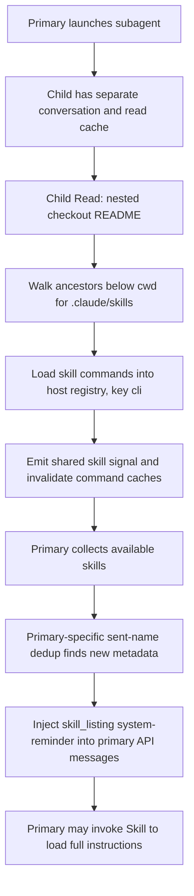

# Claude Code 2.1.296: subagent discovery exposes skills to the primary agent

Investigated 2026-10-11 against the unmodified Linux x64 binary recorded in
the [binary manifest](claude-code-2.1.296-workflow-binary-manifest.json).

## Conclusion

The observed sharing is real: a subagent's `Read` of an ordinary file in a
nested checkout registers that checkout's skills in a shared registry. The
primary agent's next skill-listing assembly consumes that registry and places
the discovered names/descriptions into its actual model request. This happens
even when the child returns a fixed answer containing no skill information
and the primary never reads the checkout itself.

The automatic injection is **availability metadata**, rather than the whole
SKILL.md instruction body. The primary can subsequently invoke the discovered
skill and load its full instructions. Additional controls showed that reading
or invoking a skill inside the child did not automatically put its body into
the primary's requests. Conversation histories and several context fields
remain separate, but the available-skill registry is shared.

This conclusion is supported by exact target-binary control flow and ten
credential-free runtime controls. It establishes a mechanism matching the
user's observation; it does not reconstruct the user's earlier run.

## The code path



These are actual minified symbols in the extracted `.bun` section. Ranges are
byte offsets with exclusive ends; complete hashes and source correspondence
are in [the symbol catalog](claude-code-2.1.296-subagent-skill-isolation-correspondences.json).

| Step | Target symbols / ranges | What the code establishes |
| --- | --- | --- |
| Subagent context | `air` `[129017688,129021998)` | Clones read state and creates fresh discovery triggers; retains session access |
| Read trigger | `nOr` `[130024567,130027172)` | Calls discovery with session.host and the file path; there is no main-agent-only condition |
| Discovery dispatch | `uj` `[129877702,129877882)` | Finds directories and starts loading their commands |
| Ancestor walk | `OAr` `[129874659,129875653)` | Looks for `.claude/skills` below cwd and excludes gitignored directories |
| Registry ownership | `xr` `[121379361,121379397)`, class `s` `[121376622,121379219)` | Registry belongs to the host; the default dynamic-state key is `cli` |
| Dynamic state | `FX`, `Ly`, `$X` `[129873562,129873795)` | Selects the registry state by that key, without an agent ID |
| Register commands | `lYt` `[129875729,129876772)` | Inserts commands keyed by skill root/name and emits the shared change signal |
| Cache invalidation | `te` `[136266006,136266388)`, `WC` `[128153966,128154012)` | The registered listener clears command caches after discoveries |
| Read available commands | `uEo` `[128150832,128153141)`, `UDe` `[129876772,129876940)` | Merges dynamic commands into the ordinary command source |
| Primary listing | `ILr` `[130169261,130169988)` | Reads that command source and builds the listing for the current agent |
| Per-agent dedup | `PLr` `[130168456,130168914)` | Tracks names already announced per agent; this scopes announcements, not registrations |
| Prompt formatting | `J5t` `[128509014,128510121)`, `pvt` `[128507426,128507511)` | Formats names plus description/whenToUse, subject to a listing budget |
| Model-message injection | `skill_listing` property `[130940826,130940986)` | Wraps the listing in a meta user message/system-reminder |
| Full instruction loading | `aYt` `[129855252,129858176)` | Its invocation callback expands the markdown body when the skill is called |

The primary's session allowlist filter (`Mne`) can limit displayed skills, but
it is not a filter for which agent discovered them. Directory-scope labels
such as “applies when working on files under architecture-context/” likewise
describe applicability; they do not provide agent ownership or isolation.

## Why the separate subagent context does not prevent this

The child context has a separate read cache and a fresh
`dynamicSkillDirTriggers` array. Those fields control read deduplication and
discovery notifications. The loaded commands live outside that context in
the host extension registry. Changing that registry affects command lookups
in both agents.

Listing delivery is explicitly keyed by agent ID. That prevents the child
from suppressing a listing the parent has not seen. Because availability is
shared, the parent's separate sent-name set actually ensures it receives the
newly discovered skill on a later request.

Full invoked-skill content uses separate bookkeeping: `VZ` records an agent
ID and `mIo` filters by agent ID. This is distinct from the dynamic skill
registry. The body-isolation controls match that distinction; compaction and
all forked-skill modes were not exercised.

## Runtime proof

The fixture has the same relevant layout as an architecture-context checkout:

```text
fixtures/                         primary working directory, Git repository
└── architecture-context/
    ├── README.md                 innocent content; no skill information
    └── .claude/skills/isolation-fixture/SKILL.md
```

The skill's name, description and instruction body have separate markers.
The API stub directs the child to read README.md and then returns only
`CHILD_FIXED_ANSWER_WITHOUT_SKILL_DETAILS`. It never asks the child to read or
invoke the skill in the baseline. The parent only launches the child and
receives a fixed answer; it performs no direct checkout file operations.

In the baseline capture sequence:

1. Primary request 1: no fixture skill name, description, or body.
2. Child request 2: the mock calls `Read` on README.md.
3. Primary request 3: the agent is still running; no fixture metadata yet.
4. Child request 4: metadata has appeared in its context; it returns the
   fixed answer without repeating that metadata.
5. Primary request 5: a separate message includes the fixture name and
   description, with the checkout applicability label. No body marker appears.

The checked-in [control summary](claude-code-2.1.296-subagent-skill-isolation-controls.json)
retains the fixture-bearing lines and their API message paths. The complete
scoped captures, fixture hashes, argv, debug logs and transcripts remain in
the ignored `tmp/claude-code-binary-analysis/2.1.296/traces/subagent-skill-*/`
directories. Full system prompts, unrelated tool schemas and credentials are
not retained in the API capture files.

| Control | Primary gets metadata | Primary gets full body |
| --- | --- | --- |
| Explore reads nested README | Yes | No |
| general-purpose reads nested README | Yes | No |
| Workflow agent reads nested README | Yes | No |
| Child returns without a file operation | No | No |
| Explore uses only Bash cat on README | No | No |
| Explore reads a gitignored checkout | No | No |
| Project settings source disabled | No | No |
| Child reads SKILL.md directly | Yes | No |
| Child discovers then invokes Skill | Yes | No |
| Primary invokes Skill after child discovery | Yes | Yes, after invocation |

The local architecture-context checkout inspected for layout correspondence
contains fourteen `.claude/skills/*/SKILL.md` files. Its paths/hashes and HEAD
are in the symbol catalog; it was not modified or run through a real model.
The reproduction uses an authored fixture to isolate the mechanism from
that checkout's instructions, real credentials, and model summaries.

## Preconditions and limits

- This proof applies to the pinned 2.1.296 binary and local in-process agents.
- Directory discovery walks from the read file toward cwd, below cwd.
  An arbitrary sibling checkout outside that tree is not covered by this proof.
- Gitignore, disabled project settings, plugin-only policy, simple/bare modes,
  remote-call handling, manual-only skills and session allowlists can change
  whether a command is loaded or announced. Gitignore and disabled project
  settings were varied at runtime; other restrictions were read statically.
- Breadboard's ignored `checkouts/` path is not equivalent to the unignored
  positive fixture. The parent cwd and ignore rules matter when attributing
  a particular earlier run.
- The Bash control covers one `cat` operation without cwd changes. It does
  not establish that every Bash or directory-change path avoids discovery.
- Metadata inclusion does not establish that the model obeyed the skill,
  or that its full instructions were automatically included. The captures
  distinguish those stages explicitly.

The older unofficial source agrees on the shared registry/per-agent-listing
relationship, but differs in storage organization and notification rendering.
In particular, its dynamic_skill attachment was UI-only, while this target
can serialize a dynamic notification into model context. The current proof
comes from the exact bundle and API captures, not the old comments.

## Reproduction and verification

Run from the repository root, using a new output directory for every probe:

```bash
python3 scripts/claude_binary_analysis/run_subagent_skill_experiments.py \
  tmp/claude-code-binary-analysis/2.1.296/input/claude \
  tmp/claude-code-binary-analysis/2.1.296/traces/subagent-skill-explore-read-v2 \
  --case explore-read

python3 scripts/claude_binary_analysis/verify_subagent_skill_controls.py \
  tmp/claude-code-binary-analysis/2.1.296/traces \
  /tmp/subagent-skill-controls.json

python3 scripts/claude_binary_analysis/validate_claims.py \
  scripts/claude_binary_analysis/docs/claude-code-2.1.296-subagent-skill-isolation-claims.json \
  --check-paths
```

The verifier checks the ten retained `*-v1` cases: initial primary absence,
actual child tool sequence/results, a fixed child answer, fixture hashes,
metadata presence/absence, and body presence only after a primary invocation.
The server supplies deterministic API responses; no paid inference is used.
Mock model names/token counters are not evidence of a real model run.

The [claim ledger](claude-code-2.1.296-subagent-skill-isolation-claims.json)
records nine evidence-labeled claims. A proposed isolation fix would need to
scope dynamic registration or the primary's command view by discovery owner;
changing sent-name deduplication alone would not address the shared registry.
No harness fix or upstream report was attempted in this investigation.
