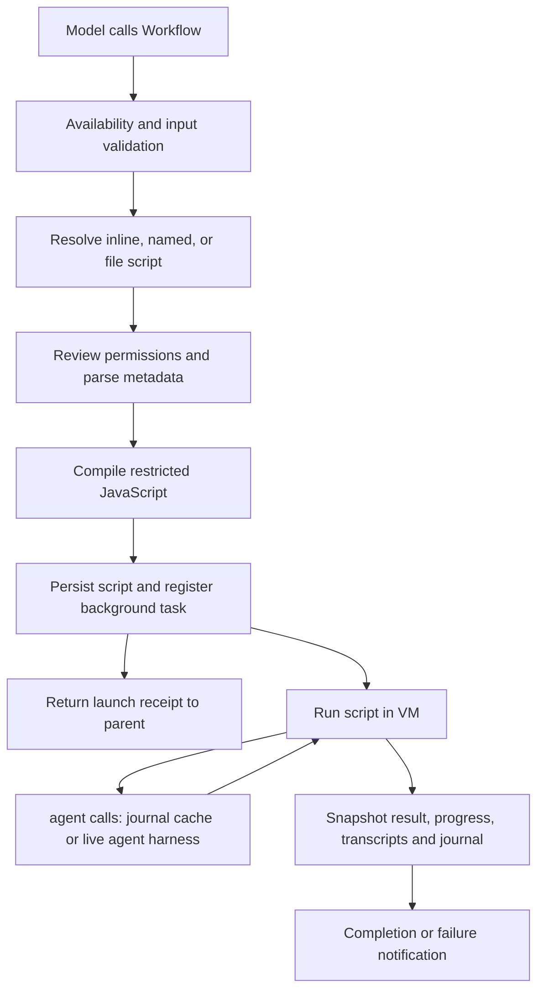

# Claude Code 2.1.296 workflow system: binary analysis

Investigated 2026-10-11. The installed Linux x64 binary matches the checksum
of the official latest release, built 2026-10-09:
[release manifest](https://storage.googleapis.com/claude-code-dist-86c565f3-f756-42ad-8dfa-d59b1c096819/claude-code-releases/2.1.296/manifest.json).

## Result

Claude's native workflow system executes a plain JavaScript orchestration
script in a restricted VM inside the Claude process. The script controls
branching, loops, fan-out, and composition; each `agent()` call runs a separate
agent conversation through the existing agent harness. The parent tool returns
an asynchronous launch receipt. The workflow's eventual result arrives in a
task notification and is saved separately.

This investigation recovered the control flow from the exact binary and
verified 16 isolated runtime controls. It did not reconstruct a build from
the unofficial source checkout. That checkout omits the WorkflowTool and
LocalWorkflowTask implementation directories, though their integrations are
visible in `tools.ts`, `commands.ts`, `tasks.ts`, task progress, session
storage, and the old Bun feature shim.

## Evidence and reproduction

- [Binary manifest](claude-code-2.1.296-workflow-binary-manifest.json):
  binary SHA-256 `24972e3bc859fab2b46ed4c1e51f7d6130f06d3bd550811a114640de3370d0de`.
  Extracted `.bun` size is 167,890,151 bytes; SHA-256
  `32a4df7685c914cf66238ffa9b1ea3ae1b164688039364d660c4506f68fb8e2f`.
- [Parsed correspondences](claude-code-2.1.296-workflow-correspondences.json):
  twelve topic groups with exact module/function byte ranges, hashes, exports,
  and local symbol-index paths. Offsets are in the extracted section and use
  exclusive ends.
- [Claim ledger](claude-code-2.1.296-workflow-claims.json): seventeen claims
  labeled by evidence level, with specific limitations.
- [Verified controls](claude-code-2.1.296-workflow-controls.json): actual
  persisted results and API request counts, checked by an executable verifier.
- [Original pseudocode](claude-code-2.1.296-workflow-pseudocode.md).
- [Tool instructions](../README.md).

Generated material remains in the ignored
`tmp/claude-code-binary-analysis/2.1.296/` tree: immutable input copy, section,
printable index, carved/formatted modules, parsed symbol indexes, fixtures,
mock API captures, debug logs, snapshots, and agent journals/transcripts.
Each runtime directory has the invocation and fixture inputs in `command.json`.

The payload now contains multiple ES modules. The old printable-index
heuristic identifies an anchor-rich module, not the complete application.
This investigation followed explicit import/export bindings, also inspecting
modules below that index's 4 KiB long-run threshold. Carved modules were parsed
with the pinned Prettier 3.6.2 Babel parser without execution. Every cataloged
symbol hash was checked against its exact original payload bytes.

## Availability and discovery

The binary includes Workflow directly; the old source shim's
`WORKFLOW_SCRIPTS` build flag is not evidence of current availability. The
current tool checks organization policy (`allow_workflows`), rollout/session
availability, `enableWorkflows`, and `disableWorkflows`. The environment also
exposes enable/disable switches. A fresh user configuration with
`enableWorkflows:false` removed the tool from the outgoing API tool list.
The other gate combinations were read from the bundle.

Named workflows combine built-ins, plugin workflows, and user/project `.js`
files. Filesystem definitions use `meta.name`, rather than the filename.
User definitions are loaded from the configured Claude directory's
`workflows/`; project definitions come from discovered `.claude/workflows/`
directories. Project definitions override user definitions. The combined
merge favors filesystem definitions over plugins over built-ins. A malformed
override preserves an earlier valid definition. Plugin paths support a
conventional directory plus custom directories or `.js` files.

Discovery requires `.js`; `.ts`, `.mjs`, and `.cjs` files are not registered by
the directory loader. User/project discovery is alphabetically sorted by
metadata name. Plugin discovery is cached, and a workflow cache invalidator
exists. Built-in-only/name-only session restrictions can suppress external
definitions. Plugin collisions and restricted modes were inspected statically.

A workflow slash command is a prompt command whose generated instructions
ask the model to invoke `Workflow({name, args})`. Slash arguments become a
trimmed string. Direct tool invocation can supply arrays/objects as `args`.

## Script contract and execution

The first statement must be `export const meta = {...}`. Metadata is a pure
literal: computed keys, spreads, interpolation, calls and accessors are
rejected. `name` and `description` must be nonempty strings; `title`,
`whenToUse`, and phase descriptions are optional. Phase metadata describes the
progress display; it does not impose a dependency graph or phase barrier.

Invocation resolves `scriptPath` before `name` before an inline `script`;
when both a source selector and `script` are supplied, the resolved path/name
can carry the inline override. File reads check readable scope, regular-file
identity, hard links, resolved path permissions, and size. The configured
script limit is 524,288: strings use the string-length limit, while disk reads
enforce bytes. A named workflow's description/title tool inputs are ignored
in favor of its metadata.

The default permission decision asks for workflow review; named rules can
allow, ask, or deny. File-based invocation expands the readable script into
the approval input. Runtime probes used bypassPermissions inside fresh local
fixtures; interactive approval rendering was inspected only.

The script body is compiled as an async function and runs in `node:vm` with
string/wasm code generation disabled. Host APIs include `agent`, `parallel`,
`pipeline`, `workflow`, `phase`, `log`, bounded timer plumbing, `args`, and
`budget`. Values cross explicit cloning/sanitizing wrappers. `process` and
`require` were undefined in the runtime probe. Dynamic imports are rejected.
Current time and random generation are blocked; known inline expressions are
also rejected before launch. Determinism supports result replay.

Scripts cannot directly use Node filesystem APIs; agents can use their
permitted session tools. The default workflow agent has the session tool
surface and connected MCP tools, with recursive Agent/Workflow spawning
excluded. Custom agent types, schema, model, effort, and worktree isolation
are resolved through the existing agent harness. Worktrees are cleaned up
when unchanged. Script options can further deny tools and clamp Bash commands;
malformed narrowing rules refuse the spawn. These branches were inspected
statically, except the ordinary and schema agent paths.

The Bash tool's own invocation path was recovered from the exact bundle
(bundle-confirmed, not runtime-probed). Its default mode is a **resident
shell**, not a per-command subprocess: the session keeps one
`spawn("/bin/bash", ["--noprofile", "--norc"], {stdio: pipes, detached: true,
env: process.env minus ANTHROPIC_*, PS1/PS2 empty, TERM: dumb})` (payload
offset ≈142183616; tool registration `name:"bash"` at ≈142185897). Each call
writes to that process's stdin as `{ <command>\n } </dev/null 2>&1;
printf '\n<sentinel>%d\n' $?` with a per-call random sentinel (split by a
quoting idiom so the command text cannot match it), then awaits the sentinel
in a rolling, truncating output buffer under a timeout/AbortSignal, and
parses the exit code from the digits after it. Persistent cwd/env is the
same process living across calls; the `restart` input respawns it, and
`close()` SIGKILLs the detached process group. When sandboxing is enabled, a
separate one-shot path builds `argv: [shell ?? "/bin/bash", "-c", wrapped]`
(≈124089233), where the wrapper composes platform sandbox policy, file ACLs
and network proxies around the command. The group-kill on close is why the
operations controls observed TaskStop, SIGTERM and the print ceiling
terminating in-flight fixture shells with no late writes.

### No workflow path into the tool-execution layers

Combining the runtime controls with the bundle findings: no layer of that
Bash machinery is callable from a workflow script. The chain from script to
shell is `script → agent() → model conversation (tool_use) → harness dispatch
by tool name → Bash tool object → resident shell`, and each hop is gated:

| Layer | What would be needed to reach it from the script | Why it fails |
| --- | --- | --- |
| Tool registry / `bash` tool object / resident-shell class | A reference to the host object | The VM context holds no such references, and none can be obtained: the full global enumeration found only the orchestration helpers; `require`/`import()` are unavailable; `eval`/`Function` throw; prototypes are frozen (no cross-boundary pollution); and the clone/sanitize wrappers strip function references from every value crossing the boundary. The internal resolver is unnameable in source (`__wRg$` prefix rejected at parse) |
| The model turn | A parameter on `agent()` that invokes a tool directly | No such parameter exists. `agent()` options only *narrow* the surface (tool denials, Bash clamp); emitting the `tool_use` block remains the model's decision, promptable but not forceable |
| The resident shell | Access to the session's shell instance | Private to the agent harness/session that created it — a different conversation's infrastructure |

Once the model emits a `tool_use` block, dispatch and execution are automatic
(harness dispatch by name, then the resident-shell stdin protocol above) —
but the script controls neither gate. Its only touchpoints on the tool layer
are negative and configurational: per-call tool denials, Bash clamps, and
the session/MCP surface the agent inherits. The claim is verified absence
per route, not proven impossibility: each known escape hatch was
individually confirmed closed (globals, codegen, prototypes, parser rules,
cloning), but the wrappers were not exhaustively fuzzed.

Design consequence, tied to the evaluation findings: a workflow can shape
work — fan-out, sequencing, budgeting, retry — but every effect passes
through two consent gates it does not control: a model choosing to call a
tool, and the harness choosing to honor it. That is exactly the boundary
where S1's reliability defects live (specialist prose lost in the Skill
result projection, reviewer forks inheriting `StructuredOutput`), and the
motivation for the external-runner recommendation: outside the agent, a
bash script invoking a command is a direct function call with inspectable
status and output, rather than a model-mediated handoff.

### JavaScript authoring capabilities

An additional [language probe](claude-code-2.1.296-workflow-language-probe.json)
confirmed classes/private fields, generators, async generators with `for
await`, promises, Map, Set, RegExp, typed arrays, Intl availability, and
setTimeout/clearTimeout. An explicitly dated Date object worked; current-time
construction did not. The script body supports ordinary declarations,
functions, loops, branching, exceptions and top-level await/return because
the harness wraps it in a strict async function.

The same probe found process, require, fetch, Buffer, URL, URLSearchParams,
TextEncoder, crypto, performance, AbortController, setInterval, setImmediate,
queueMicrotask and WebAssembly absent. Eval and Function string compilation
threw. Built-in prototypes were frozen, and patching Array.prototype failed.
Ordinary mutable arrays/objects and user-defined classes remain usable.
Source parsing additionally prohibits import(), with statements, await using,
and identifiers beginning with the reserved internal prefix `__wRg$`.
Static imports/extra exports cannot occur in the async script body. Authors
must supply a self-contained JavaScript program; TypeScript and dependency
loading are unavailable. Plain JSON-compatible values are the reliable
transfer/result format; host boundaries sanitize and clone objects.

A follow-up enumeration of the sandbox's complete global surface
(`workflow-vm-globals-probe-v1`, 75 properties) confirmed there is no
import-free subprocess path either: although the host binary is a Bun
executable, `Bun` (and `Deno`) are not injected into the context. The only
non-standard globals are the orchestration helpers (`agent`, `parallel`,
`pipeline`, `workflow`, `phase`, `log`, `args`, `budget`, `setTimeout`,
`clearTimeout`, `console`) plus the internal `__wRg$resolve`; everything else
is pure ECMAScript (including `Temporal`). `eval` exists as a global but
throws when invoked.

The engine supplies a 30,000 ms timeout to the initial synchronous
`vmScript.runInContext` call. This is not a 30-second total workflow deadline,
and the inspected timers/async continuation callbacks do not receive that
same runInContext timeout. No separate per-workflow heap quota or overall
wall-clock deadline was identified in the examined local engine path.
The 4,096-element limit applies to helper inputs and arrays crossing guarded
VM boundaries; it is not a restriction on the size of every array a script
may create internally. The 1,000-agent counter is created afresh per engine
execution, and cached agent calls increment it as well.

## Scheduling, results, and failure handling

`parallel` accepts thunks, starts them together, waits with `allSettled`, and
retains input positions. Rejected branches become `null`. `pipeline` runs
each input through its stages independently, passing previous result,
original input, and index. An item reaching `null` skips subsequent stages;
a thrown stage makes that item's final slot `null`. There is no barrier
between stages across items. Runtime ordering showed item 2 finishing its
second stage before item 1 finished its first.

Default live agent concurrency is `min(16, max(2, availableParallelism - 2))`;
an environment override exists. Excess agent calls queue. The lifetime call
cap is 1,000. Array helpers use a 4,096-item bound. These ceilings were
recovered statically, not stress tested.

Without a schema, the harness takes the last assistant response's text as
the agent result. It normalizes marker content and can append file records or
warnings. It does not establish that this prose is an assessment, valid JSON,
or a complete answer. With `schema`, the agent must produce a validated
StructuredOutput attachment; ordinary prose does not substitute. The mock
probe confirmed a structured object return, and a missing structured result
failed after an in-conversation nudge.

Skipped agents and terminal API errors can return `null`; stall/retry
exhaustion can throw. Local stall recovery permits up to five retry iterations;
throttling and rate limits have separate handling. These error branches were
first read statically; the [operations controls](claude-code-2.1.296-workflow-operations.md)
then induced deliberate stalls, quota-style failures, crashes and cancellation
at runtime and confirmed the counts, side-effect duplication and terminal
states reported there.

### Failure and recovery architecture

Recovery is layered, and each layer fails differently (full policy and tables
in the [operations report](claude-code-2.1.296-workflow-operations.md)):

1. **Request-level retries** — transparent and side-effect safe: the same
   conversation is resent, so tool results are not re-executed. Retryable:
   socket errors without HTTP status (ECONNREFUSED/ECONNRESET/ETIMEDOUT/
   EPIPE), 408, 409, SSE failures, ≥500, 404 (once, without streaming), 401
   (via a two-use credential-renewal budget), 529 (a separate bucket with
   fallback-model handling after three repeats), and ordinary 429s. **Not
   retryable:** 429s carrying spend/usage-limit markers
   (`service_spend_limit_reached`, `org_spend_cap_reached`, `out_of_credits`…)
   — they fail the request immediately. Default budgets are 300 retries for
   first-party auth and 10 for third-party/gateway (`CLAUDE_CODE_MAX_RETRIES`
   clamped to 15 for non-first-party); delays are exponential (~0.5 s base,
   factor 2, 32 s cap) with proportional jitter, `Retry-After` and
   `anthropic-ratelimit-unified-reset` honored, and large-window 429s enter
   a wakeable long wait of at least ten minutes.
2. **Conversation restart** — when request retries exhaust, the agent
   conversation is restarted from scratch once, re-executing its tool side
   effects. Stall recovery is a separate path permitting five restarts.
3. **Workflow outcome** — a terminally failed agent journals `failed` and the
   workflow *completes* with a `null` result (or throws if uncaught in a
   direct `await agent()`), with CLI exit 1 and an `is_error` result event.
4. **The notification turn** — the controller is quiescent at the API level
   during background execution; its next request delivers the terminal
   notification. That turn uses the same retry engine, and its terminal
   failure yields an API-error CLI result and exit 1 **even when the
   workflow completed and its result is durably journaled**.

An uncaught error fails the workflow. A caught branch error can leave the
outer workflow completed with `null` slots and recorded failures. Runtime
controls established both outcomes for the same missing structured result:
direct `agent()` failed; wrapped in `parallel()` it completed with `[null]`.
Consumers must inspect returned values/failures and validate task-specific
requirements, rather than accepting completion status alone.

The script API advertises token-budget hooks, and the agent gate implements
them, but this exact local launch path initializes `tokenBudget.total` to
`null`. The runtime confirmed that value. Do not assume a user token directive
creates a hard ceiling for this path without a separate integration test.

## Journal and resume

Each non-null successful agent result is appended to `journal.jsonl` alongside
launch/start/failure records. A `v2:` SHA-256 key chains the prior key, current
prompt, and canonical options affecting the result: schema, model, effort,
isolation, agent type, denied tools, and Bash clamp. Label/phase/stall timeout
are outside this canonical result key.

Resume loads the prior journal and reruns the script. Calls in the unchanged
prefix reuse completed results. The first new/changed call disables later
cache reuse; in-progress/failed records support respawn rather than a usable
cached result. Same-session resume rejects a still-active run. Hidden-script
resume has additional exact-script restrictions.

The runtime sequence made two initial agent API requests, zero on an
identical replay, zero after relabeling, and one after changing only the
second prompt. The final progress snapshot marked the first call cached.
Cross-process restoration and concurrent resumptions are runtime tested in
the [operations controls](claude-code-2.1.296-workflow-operations.md): a
fresh-process `resumeFromRunId` restores from the journal alone, and two
concurrent resumptions of a completed run both served cached results without
corruption.

The script return value is separate from individual agent journal results.
Run snapshots contain final result, status, script/args, progress and totals.
Agent transcripts and the journal live under the session's
`subagents/workflows/<runId>/`; the saved script is under `workflows/scripts/`.

## Where the determinism guarantee ends

The workflow system removes non-determinism from the orchestration layer —
no clock, no randomness, journal-replayable scheduling — but does not remove
it from the system: it quarantines it below the `agent()` boundary. Every
effect remains a stochastic model turn: the model decides whether to emit the
tool call, what the command is, when to stop, what to return, and whether to
end on text or a `StructuredOutput` call. Comparing the evaluated designs
across the three layers that actually exist:

| Layer | S1 (native Workflow) | S2 (external bash runner) |
| --- | --- | --- |
| Orchestration (sequencing, fan-out) | deterministic JS | deterministic bash |
| Effects (push, write, read) | stochastic — model-mediated | deterministic — direct calls |
| Content/judgment (strategy prose) | stochastic | stochastic |

The workflow fixed the top layer and left the middle one stochastic; the
external runner pushes non-determinism down to the only irreducible layer,
the judgment content. The middle layer is where production reliability
lives (did the push happen, was the review delivered), which is why the
benchmark's handoff-fidelity findings dominate its scheduling findings.

The encapsulation is also leaky at the interface. The boundary is typed
(schema) but not trustworthy: a successful result's content is not
semantically validated unless the caller enforces a schema, and the
[handoff diagnosis](claude-code-2.1.296-workflow-specialist-handoff.md) shows
the delivered value is not guaranteed to be the sub-agent's work at all —
ten of twelve specialist results crossed as `Skill execution completed`.
A deterministic scheduler consuming lossy stochastic returns is reproducibly
wrong, not reliable. Replay does not fix this: replaying a stochastic node
means serving its cached output — including stale results when shared state
changed (operations control `replay-shared`) — so the determinism guarantee
stops at the `agent()` boundary in both directions. Even failure semantics
remain stochastic: the same logical failure crosses as `null` (skip), a
throw (missing structured output), an extra nudge turn, or a full
conversation restart (stall recovery), depending on model behavior.

This structure follows from the sandbox design: with no syscalls, filesystem
or network in the VM, the model is the only available executor, so effects
must be model-mediated by construction. The determinism constraints exist to
make the journal work, not to make effects reliable — the layer that could
be hardened was hardened, and the rest was moved downstairs. The production
consequence, matching the evaluation plan's recommendation: correctness rests
on the contracts at the `agent()` boundary, so persist and externally
validate every role's output rather than trusting workflow completion,
schema presence, or CLI exit status.

## Composition, lifecycle, and inactive branches

Result-driven fan-out is ordinary JavaScript and is runtime-confirmed
(`workflow-fanout-v1`, plus the `workflow-orgscan-v1` variant in which a
clone agent first runs a script via its Bash tool and returns the checkout
folder list, which then drives the per-repo scan agents): one `agent()` returns a schema-validated list, a
`for...of` loop over `list.items` awaits one `agent()` per item with a
result-derived prompt, and the script assembles the final value — the journal
records the chained keys (`FANOUT_LIST` → `FANOUT_ITEM:alpha` → …), each
derived from the prior key plus the result-dependent prompt. Because journal
keys chain on prompt content, replay reuses the cached prefix and a changed
early result naturally invalidates later cache entries. Fan-out through
`parallel()`/`pipeline()` follows the same rules with bounded helper inputs
(the 4,096-element crossing limit) and the shared concurrency cap; the
1,000-agent counter includes cached calls. A terminally failed item call
resolves to `null` on the direct-await path, so loops should check for it.

A schema constrains the *type* of a result, never its *reference*: it can
require `repos: [{name: string, path: string}]`, but it cannot require that
those strings name directories that exist on disk. When a returned list
drives further work, four failure modes apply with asymmetric
detectability — invention, mutation and reordering are largely caught by
consumers that touch the referenced reality (a scan agent told to read a
hallucinated path finds nothing and fails), but **omission is silent**: an
item the agent never reports never enters the fan-out, and nothing fails.
`scanned: N, failed: 0` is not evidence the batch was complete. Two
mitigations are available inside the script itself: a cardinality
cross-check (demand a count from a second transcription or the script's own
output and compare it to the list length in plain JS — an agent omitting
entries must also falsify the count consistently), and moving the data path
off the model boundary entirely (the script writes a manifest; agents read
it from disk). The benchmark's production failures are precedents for the
omission class: an agent returning its result as a JSON string inside
`recorded` silently excluded that item from scoring/review, and reviewer
scope drift mutated the "which item" parameter. See the evaluation plan's
production recommendation for the external-validation conclusion.

`workflow(name,args)` executes a child in a separate VM while sharing the
parent agent hooks, concurrency/call caps, journal and budget. Runtime named
child composition succeeded. Child `phase()` is suppressed in favor of a
child progress group; a child's attempt to call `workflow()` again rejects.
The one-level nesting rule was inspected statically.

Background tasks keep agent controllers, merge progress by type/index, emit
SDK progress, save a final snapshot, and notify completion/failure. The
controller conversation is quiescent at the API level while the background
workflow executes; its next request is the notification-delivery turn, which
uses the same retry engine and — on terminal failure — yields an API-error
CLI result and exit 1 even when the workflow itself completed and its result
is journaled (see the [operations controls](claude-code-2.1.296-workflow-operations.md)).
Individual
skip and retry use distinct abort reasons. Stop marks the task killed and
signals its registered work. Interactive controls and cancellation races were
not exercised; their control flow was recovered from the bundle.

The Workflow tool's optional run-operation extension is compiled to an empty
function in this module. Schema strings mention remote result variants, but
that does not demonstrate remote execution through this local invocation.
`agent({isolation:'remote'})` explicitly throws unavailable in this build.
Remote execution paths elsewhere in the product were outside these controls.

## Runtime controls and verification

All controls use the unmodified release, a fresh configuration and fixture
repository, a deterministic loopback Anthropic SSE/JSON server, and no real
credentials or paid model calls. This tests harness behavior, not model
quality. Inference-looking model names and cost counters are mock response
accounting; they do not identify an actual model run.

| Control | Observed result |
| --- | --- |
| Plain script return | Object args preserved; process/require absent; budget total null |
| Pipeline | Results `[3,5,null]`; per-item stages overlap; failed item skips next stage |
| Parallel | Results `[7,null,9]`; outer workflow completed |
| Missing metadata | Rejected before launch |
| Current time | Rejected before launch |
| Dynamic import | Compile rejection before launch |
| Ordinary agent | Final text returned and journaled |
| Schema agent | Validated object returned and journaled |
| Schema with prose only | Direct call failed after nudge |
| Same schema failure in parallel | Completed with `[null]` |
| Resume sequence | Agent API requests by round: `2,0,0,1` |
| User/project collision | Valid project copy wins |
| Invalid project override | Valid user copy retained |
| `.ts` named definition | Not discovered |
| Disabled workflow setting | Workflow omitted from offered tools |
| Named child composition | Child result returned through parent |

The verifier checks persisted background states and request counts, rather
than CLI exit status. Verification: 16 controls passed; eight tooling tests
ran, seven passed and the optional installed-Bun compiler fixture was skipped.
The Unicode symbol-index test confirms byte offsets/hashes and refuses a
tampered carve. Claim paths, catalog hashes and `git diff --check` were also
checked. No binary, extracted code, source checkout, credentials, or runtime
logs were added to tracked source.
