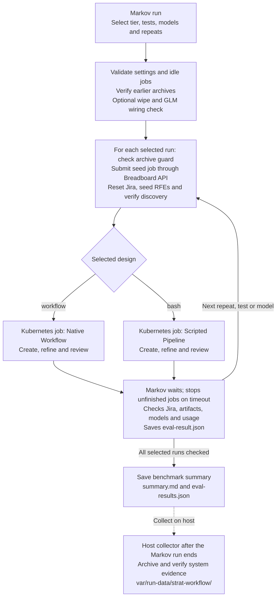

# strat-workflow benchmark

Compares two designs for strat-creator's strategy pipeline on the same RFEs:

- **workflow:** the Claude Workflow from strat-creator PR #83, started with
  `scripts/run-workflow.sh`;
- **bash:** PR #80's bash entrypoint, `.fullsend/scripts/strategy-entrypoint.sh`.

Each design runs as it is, as a dashboard script job, with Model Relay,
MLflow, OTel, strace and API dumps. The plan, its pass criteria and all
results so far are in
[`.ledger/plans/strat-workflow-eval-plan.md`](../../../.ledger/plans/strat-workflow-eval-plan.md).

Read [the analysis](analysis.md) for the findings, testing budgets and production
recommendation.

The current production direction is [S1 hardening](../../../.ledger/plans/strat-workflow-s1-hardening.md)
after custom entrypoints were rejected. Historical comparison pins stay unchanged.
Iterative repair tests use GLM, one execution per case/revision. Focused dashboard
jobs can be archived with `archive_run.py --job <name> --root
var/run-data/strat-workflow-hardening`; this includes API dumps, strace, native
state and available shared-system snapshots. Use `--wait <seconds>` to collect
after completion. The collector records direct-job provenance and does not
represent these jobs as Markov runs.

The `s1-mixed-glm` tier runs one GLM iteration at batch limit ten and agent
concurrency ten. It seeds 18 RFEs and 11 STRATs: fresh work, existing drafts,
two genuinely pushed review-only strategies, missing provenance, cleared and
uncleared human gates, active/closed work and a foreign claim. The human-sign-off
gate runs after discovery's cap, so this fixture selects ten, acquires nine and
defers one actionable RFE. Its pre-inference guard checks that exact outcome.
Earlier all-new scenarios and Tier 1 retain their original pins and behavior.

The separately authorized `s1-mixed-opus` tier uses the same fixture with
`claude-opus-4-6`, one iteration and cap ten. Its wrapper ends the primary
invocation on a failed native Workflow, then performs normal validation,
lock release and evidence capture. It records the native failure in
`workflow-failure-stop.json`; it does not launch repair work. Other tiers keep
their original monitor settings. Rich seed reports reach the independent
checker through stdin so their size cannot exceed an exec argument limit.

The mixed job saves before/after Jira inventories, exact prepared resume points,
provenance and per-ticket checks. After successful cleanup it prepares once more
against unchanged Jira, without Claude: completed work must stay excluded,
the deferred RFE remains available and the foreign claim stays intact. These
reports and the model job's native/API/syscall evidence use the normal archive.
Run the optional local emulator test without inference using
`STRAT_CREATOR_CHECKOUT=<checkout> <checkout>/.venv/bin/python -m unittest discover
-s var/benchmarks/strat-workflow/tests -p test_mixed_state.py -v`.

This directory is a Markov directory workflow. Markov runs on a runner pod.
Its steps call the dashboard API, watch the job pods with `k8s_job_wait`,
and run the checks. Every model call happens in the job pods.

## Workflow overview



Each test selects one design; benchmark selections run sequentially. Failed
strategy jobs still reach the checks. A missing archive receipt stops the next
reset. Host collection runs separately after Markov finishes or stops, and its
verified receipt allows later resets.

## Running it from markovd

1. Push the change to `main` on GitHub. Jobs clone their scripts from
   Breadboard at the commit markovd imported, so it must be pushed.
2. In `markovd.local`, sync project 1 (Breadboard) and import
   `var/benchmarks/strat-workflow`. It appears as
   `var-benchmarks-strat-workflow`. markovd records the commit and passes it
   to every run as `workflow_source_commit`.
3. Start a run of the workflow. Useful settings (`vars.yaml`):

   | Setting | Default | Example |
   | --- | --- | --- |
   | `tier` | `smoke` | a tier in `vars/tiers.yaml` |
   | `only_tests` | all | `S1,S2` (haiku only) |
   | `repeats` | the tier's (3) | `1` |
   | `variants` | each test's own | `haiku,opus` (A/B) |
   | `wipe_at_start` | `true` | `false` keeps earlier artifacts and MLflow |
   | `job_timeout` | `7200` | seconds before a job is stopped |
   | `workflow_bg_wait_ceiling_ms` | `1800000` | `5400000` for a 90-minute S1 background wait |
   | `breadboard_ref` | the imported commit | another pushed commit |

The run refuses to start while any dashboard job is pending or running.

## Mandatory run archives

Before another benchmark reset or wipe, collect the preceding run on the
host and verify its final archive:

```bash
.venv/bin/python var/benchmarks/strat-workflow/scripts/archive_run.py --run markov-run-02336f23
.venv/bin/python var/benchmarks/strat-workflow/scripts/archive_run.py --verify var/run-data/strat-workflow/<run>/<capture>
```

The collector creates a new timestamped capture, never replacing earlier
ones. `--allow-running` permits a provisional capture; it cannot satisfy the
pre-reset requirement. Failed runs require final archives too. A successful
final capture publishes a checksum-backed receipt under
`/app/logs/strat-workflow-archive-receipts/`, which survives artifact wipes.
Use `--verify <capture> --publish-receipts` to republish after re-verification.
For an authorized run, a detached host collector can use `--run <id>
--wait 8100`: it polls for terminal run/jobs before making a final capture,
then verifies and publishes receipts. Waiting has a deadline; a failed run
is also archived. The capture timestamps describe collection after the wait.

Streamed sources have a 30-minute timeout by default; `--stream-timeout 2400`
allows 40 minutes per source for large retained volumes. The manifest records
this setting. Fast lossless gzip preserves the same files and completion
inventory. A timeout still makes the capture incomplete and prevents a final
receipt. Retry collection into a new capture after resolving the cause; retain
the earlier incomplete capture and distinguish later shared-service state from
the original post-run snapshot.

The local `var/run-data` is a symlink to `/data/breadboard`. Both the symlink
and generated evidence are gitignored; collector code and documentation are
tracked. Capture directories/files are private to the collecting user.

```text
var/run-data/strat-workflow/<markov-run>/<UTC capture>/
  manifest.json                 status, scope, source errors, sizes and SHA-256
  markov/                       full run/steps, workflow, results, runner logs/state
  jobs/<seed-or-design-job>/     metadata, raw files.tar.gz, Kubernetes logs/state/events
    api-dumps/                  directly browsable API index and request/response bodies
    strace/                     directly browsable per-process syscall traces
    artifacts/                  directly browsable job output, progress, seed/eval files
  jira/issues.json              paginated readable Jira export
  system-state/                 dashboard volumes and Jira/MLflow/Observatory snapshots
  context/                      pinned architecture and benchmark source
  logs/                         service logs since run submission
  relay/                        health, all paginated requests and usage events
```

Job evidence is available directly in these subdirectories; the original
tarballs are also retained. To expose files in an older packed-only capture,
use `--verify <capture> --unpack --publish-receipts`. This first verifies the
original capture, adds checksums for the unpacked files, verifies again, and
refreshes the receipt. It rejects unsafe archive paths and links, and refuses
to replace edited evidence.

Job tarballs preserve original paths, including API `index.jsonl`, exact
request/response bodies, strace, Claude output/stderr, native progress,
seed/eval artifacts, and publication files. Shared snapshots include all
retained artifacts, logs, issue/workspace data, and stored service files.
MLflow's database includes trace metadata and span payloads; file storage is
also copied. Jira attachments are retained with its database. Observatory's
database retains its ingested traces, OTel spans, claims and verdicts.
SQLite snapshots use its online backup API, including committed WAL data,
and are checked for consistency. Every tar stream is fully read to detect
truncation; every saved capture file has a size and SHA-256 entry.

`require_archive.py` runs before `wipe` and every `submit_seed`. The direct
seed and host reset helpers also enforce this check. It fails before any
deletion if an earlier benchmark job, starting with the first tier 2 pass,
has no verified final host receipt. For multi-test/repeat invocations this
creates an archival checkpoint between tests: the workflow stops before the
next seed, the host archives the terminal run, and execution can resume
after the receipt exists. Tier 1 remains available; a single selected test
avoids these intermediate checkpoints. The cutoff is recorded in
`archive_required_since`, including the first S1 tier 2 pass.

Archive guards apply to deployed Markov invocations after this updated
workflow is published and synced. The first S1 Haiku run used the earlier
published harness; its evidence was collected and verified on the host
after completion.

Capture completeness describes the available system evidence, not whether
the strategy passed. Snapshots are individually consistent over the
manifest's time interval, rather than an atomic snapshot across services.
Old Jira states already reset and expired Kubernetes logs/events cannot be
recovered retroactively. Full retained-state snapshots preserve earlier
evidence still present, but do not reconstruct those missing historical
states. The collector does not request relay account credentials or
Kubernetes Secrets. Raw evidence and full database snapshots remain private,
ignored data.

## GLM compatibility validation

`glm-smoke` runs one real single-RFE strategy on the selected design. Invoke
S1 and S2 separately, archiving/analyzing S1 before submitting S2:

```yaml
tier: glm-smoke
only_tests: S1
variants: glm
repeats: 1
wipe_at_start: false
```

Use `only_tests: S2` for the separately authorized second pass. This tier
rejects multiple designs, more than one repeat, another model or artifact wipes.
It preserves the original design pins and single-RFE scenario. Before S1, a
small `selfcheck.sh --call-model` job validates real job wiring without changing
Jira; its traces/logs are archived in the same Markov run.

The model is `rits/zai-org/glm-5-3` through the existing Vertex relay project
`vertex-shim-local`. GLM-specific submissions explicitly pin subagents and all
default model aliases, and set medium effort. The personal upstream key stays
on the relay. Existing Haiku/Opus submission environments are unchanged.
The GLM outcome gate requires exact hosted request IDs and permits only the
verified `zai-org/GLM-5.3` response spelling as an alternative. Unknown response
models and Claude helper requests fail the model check. Provider/account routing
is reconciled separately against archived relay telemetry.

This is compatibility validation; a single run per design does not establish
quality, runtime or cost equivalence. GLM prices/context limits are not inferred
from Claude's fallback metadata. All evidence must be archived before S2's Jira
reset, using the existing collector and receipt guard.

## Hardened S1 ten-ticket validation

The completion-hook retest is `s1-pr85-completion-fixed-opus`, pinned at
`6ed858b2294a29457153a90f187a801022c21e8b`. It resets Jira and recreates the
same ten distinct requests from `batch-ten-distinct-v2`, with the same Opus
model, high effort, batch size/concurrency ten, native capture and failure
monitoring. It permits one iteration. The previous run's failed verdict and
source pin remain in `s1-pr85-distinct-ten-opus`; all archives must verify
before reseeding. The repaired completion hook passed a model-free full-batch
traced replay; this tier tests its integration with the actual Workflow.

The preceding post-review test is `s1-pr85-distinct-ten-opus`, pinned at
`2a4b7c94b93a2d43bc25fe701e225e5738e226af`, the checkpoint performance repair
that passed the subsequent one-RFE Opus smoke. It uses
[batch-ten-distinct-v2](data/scenarios/batch-ten-distinct-v2.yaml): ten entirely
new fictional requests, with no reused historical RFE templates. Each request
has its own problem, acceptance criteria and explicit scope.

| Subject | Independent deliverable |
| --- | --- |
| Disconnected installation | Check mirror image completeness before installation |
| GPU showback | Attribute historical reserved GPU hours and cost to projects |
| Collaborative notebooks | Synchronize authorized users editing one notebook |
| Pipeline approval | Hold a task for an auditable human decision |
| Model signatures | Verify artifact origin when registering a model version |
| Inference tracing | Follow a sampled request through ingress and runtime |
| Dataset licensing | Reject training inputs that violate project license policy |
| Training placement | Enforce requested accelerator/CPU locality |
| Fairness audit | Compare offline classifier error rates across groups |
| Historical feature joins | Prevent future-data leakage in training datasets |

This tier permits one S1 Opus iteration with batch size ten and Workflow
concurrency ten. Native capture, failure monitoring and strace are enabled;
global telemetry is retained. Seeding must discover exactly ten RFEs; a passing
batch requires ten separate strategies and forty delivered role assessments.
The source pin, fixture and budget belong to this tier; earlier tiers below
remain historical configurations. No reviewer dispatch change is included.

`s1-hardening-glm` and `s1-hardening-opus` run the same distinct ten-RFE
scenario from [Fullsend PR #85](https://github.com/fullsend-ai/strat-creator/pull/85).
Both now clone `https://github.com/jctanner-fullsend-ai/strat-creator.git`,
branch `feat/s1-workflow-hardening`, pinned at
`6a05210215247b287bb0fb61ed02e423c9de8692`. The pin is the verified branch/PR
head, rather than a moving branch lookup at job launch. Seeding and execution
receive the same repository and commit; run/seed/evaluation metadata records it.
Both tiers explicitly set `BATCH_SIZE=10` and
`CLAUDE_CODE_WORKFLOW_MAX_CONCURRENT_AGENTS=10`. This caps outer Workflow
agents; it does not change specialist Skill scheduling. Run metadata and the
job summary record the requested cap; tiers without an override leave the
native variable unset. Other tiers keep their original source pins. Each hardening tier permits only S1 and
one matching-model run, with `wipe_at_start=false`. GLM uses medium effort;
Opus uses high effort. Both use the native batch's 295-minute timeout and retain
the native Workflow state/journal alongside API dumps and strace.

The [ten-ticket scenario](data/scenarios/batch-ten-new-rfes.yaml) contains:

| RFE subject | Capability |
| --- | --- |
| Workbench idle-culling exemption | Keep an explicitly exempted workbench running |
| Pipeline artifact retention | Bound stored pipeline output growth |
| Feature-store materialization | Keep online feature views current on a schedule |
| Canary rollback | Restore serving traffic after a rollout regression |
| Registry archive guard | Prevent archiving a version still in service |
| Queue admission visibility | Explain why a workload is waiting |
| Drift alerts | Notify owners of threshold crossings |
| Training checkpoint recovery | Resume interrupted distributed training |
| Connection credential rotation | Verify adoption of replacement storage credentials |
| Evaluation report export | Share reproducible results from completed evaluations |

The first seven reuse existing complete templates. The final three are new
fictional RFEs with independent problems and acceptance criteria. Seeding uses
the candidate's own discovery rules and must find exactly ten eligible keys.
A complete batch expects ten separate strategies and forty role reports.
Reviewer Skills retain their current serial dispatch within each ticket; this
change raises concurrency across tickets. The reviewer-dispatch optimization
remains deferred. The existing one- and three-ticket scenarios remain available
through the historical smoke and tier-2 configurations.

Launch GLM first through markovd, with `only_tests=S1`, `variants=glm`,
`repeats=1`, `job_timeout=18000`, and
`workflow_bg_wait_ceiling_ms=17700000`. Archive and verify its final evidence.
Only a passing GLM batch permits the separately authorized Opus run with
`tier=s1-hardening-opus` and `variants=opus`; the workflow itself does not
automatically advance to another model.

Earlier three-ticket runs used the CPU-derived cap of two or an explicit cap
of five, with their exact source configurations retained in recorded commits
and archives. This ten-ticket configuration changes batch size and concurrency
together, so it cannot isolate the effect of either setting. Preparing this
configuration does not launch or authorize another model run. The seed step
creates the new emulator issues only when the next run starts.

[Completed pair and checks](../../../.ledger/tasks/done/s1-hardening-three-rfe-glm-opus.md).

## First tier 2 batch

`tier2-smoke` uses three new eligible RFEs and no existing STRATs. The full
templates cover workbench culling exemptions, pipeline artifact retention,
and scheduled feature-store materialization. Their problem statements and
acceptance criteria describe independent capabilities.

The first run uses these settings:

```yaml
tier: tier2-smoke
only_tests: S1
variants: haiku
repeats: 1
wipe_at_start: false
```

Stop and analyze S1 before separately authorizing the matching S2 run with
`only_tests: S2`. The tier refuses an empty or multiple-test selection,
additional repeats, an Opus override, or an initial artifact wipe before
making service calls. Both designs use their existing pinned commits and
real skills. S1's wrapper selects native `STRAT_MODE=batch`; S2 receives
native `batch-discover`. Both receive `BATCH_SIZE=3` and the seed's discovery
keys in query order through `BATCH_EXPECTED_KEYS`.

The seed job resets **Jira** before each selected test, validates discovery
against the exact eligible set, and records summaries, description hashes,
labels, and discovery order in `seed.json`. `wipe_at_start=false` preserves
artifacts, MLflow, and Observatory; it does not suppress the scenario's Jira
reset. A live run is a separate action from local implementation/validation.

Tier 1 remains `tier: smoke`, with `smoke-one-rfe`, tests S1–S4, their original
models and repeats, and the original single-RFE checks.

## Single Opus batch

The separately authorized Opus pass uses `tier2-opus`, the same three-RFE
scenario and unchanged design pins. It requires one explicitly selected
design, one repeat, Opus only, and retained evidence:

```yaml
tier: tier2-opus
only_tests: S1
variants: opus
repeats: 1
wipe_at_start: false
workflow_bg_wait_ceiling_ms: 5400000
```

The S1 wait budget is 90 minutes, compared with a 40–60 minute runtime
estimate. The existing outer S1 timeout remains 90 minutes. The model gate
checks all observed model calls against `claude-opus-4-6`; Haiku smoke keeps
its `haiku_only` gate. A matching S2 pass requires separate authorization.

## What a run does

```text
main
  wipe                  artifacts volume, MLflow, Observatory (once)
  rounds                for_each: repeats | seq
    round               for_each: the tier's tests, for_each_when: only_tests
      test-variants     for_each: variants | csv | default: the test's own
        run-test        seed Jira, submit the design's job, wait, check
  summarize             summarize.py over every run's eval-result; summary.md and
                        eval-results.json saved to
                        /app/artifacts/benchmarks/strat-workflow/<markov run id>/
  review                gate (off by default: markovd can't resume a pause yet)
```

`run-test`, for one test under one variant:

1. `describe_run`: one `run` record (ID, test, arm, variant, model,
   commits, MLflow experiment), kept with the result.
2. Seed: a dashboard script job runs `seed_scenario.py` at the Breadboard
   commit, and `job_wait` watches it. The run reads the job's `seed.json`
   through the dashboard's file API and asserts the seed check passed.
3. Submit the design's job: the `submit` step calls the workflow
   `submit-{{ test.arm }}` (`submit-workflow.yaml` or `submit-bash.yaml`), each
   with its full request in the YAML. `workflow_names` lists both, so Markov
   rejects an arm without a workflow and markovd draws both as alternatives.
4. `wait_for_run` is a `job_wait` with `ignore_errors`: a failed job is a
   failed test, recorded rather than raised. A job still running at the
   timeout is stopped before the next run resets Jira.
5. `check` runs `check_run.py`, which prints the run's eval-result.
   `write_file` saves it next to the job's artifacts as
   `/app/artifacts/scripts/<job>/eval-result.json`.

The Markov run fails only when the benchmark itself can't go on, for
example when seeding fails.

## Checks

`check_run.py` runs these script checks on one new RFE:

| Check | Passes when |
| --- | --- |
| `finished` | the job completed (exit 0) |
| `one_strategy` | exactly one RHAISTRAT, cloned from the RFE |
| `steps_done` | the strategy was created, refined and pushed, and has a verdict label |
| `one_review` | exactly one review comment |
| `records_agree` | the comment's verdict matches the verdict label |
| `no_half_done` | no review comment without a refined, pushed strategy |
| `locks_released` | no `strat-creator-processing` label is left |

For the new batch tier, those checks apply to **every** seeded eligible RFE.
`batch_complete` also rejects missing items, shared strategies, and orphan
strategies through the per-item project count checks. Each result contains
an `items` list of per-RFE facts/checks, and the summary shows each verdict.
`haiku_only` checks model names across request and response dumps,
including helper calls, and requires at least one successful response.

`reviewer_outputs_returned` matches reviewer Skill launches to parent
tool results by tool-use ID across the API dumps, deduplicating repeated
history. Each strategy needs returned text from feasibility, testability,
scope, and architecture reviewers. Empty `Skill execution completed`
acknowledgements fail, and reruns are counted per strategy/role. This
exposes the known S1 defect while leaving the implementation unchanged.
Verbatim preservation of those outputs in the published review still needs
inspection during the post-run analysis.

It also records the following, without pass or fail:

- wall time;
- the model calls, tokens and error responses, including 429s, summed from
  the job's API dumps.

Relay telemetry is lossy under load, so it isn't used.

## Running pieces by hand

`check_run.py` and `summarize.py` use only the standard library. They read
`DASHBOARD_BASE` and `JIRA_BASE`, so they also run from the host:

```bash
cd var/benchmarks/strat-workflow/scripts
export DASHBOARD_BASE=https://dashboard.local JIRA_BASE=https://jira.local
python3 check_run.py '<run json>' <job name> RHAIRFE-1 completed
python3 check_run.py '<batch run json>' <job name> batch-discover completed '<seed json>'
```

`reset_environment.py` does the full reset and seed from the host, with no
Markov run.

## Layout

- `vars.yaml`: run settings.
- `vars/tiers.yaml`: test lists per tier.
- `vars/arms.yaml`: each design's pinned commit and settings.
- `vars/models.yaml`: variant names to models.
- `workflows/`, `step_types/`, `rules.yaml` and `meta.yaml`: the Markov
  workflow.
- `scripts/`:
  - job side: `run-workflow.sh` and `seed_scenario.py`;
  - runner side: `check_run.py`, `summarize.py` and `benchlib.py`;
  - host side: `reset_environment.py`, `selfcheck.sh` and
    `snapshot-architecture-context.sh`.
  - analysis, run inside the dashboard pod as `python3 - <job>... < script`:
    `conv_breakdown.py`, `strace_timing.py`, `concurrency.py`,
    `file_reads.py`, `arch_requests.py` and `tool_calls.py` (every tool
    call from the API dumps, sub-agents included; `--jsonl` for one record
    per call). `context_growth.py` measures each conversation's input
    context per request using exact `index.jsonl` pairs; `--json` emits
    the time series, including a separate `primary` conversation for S1.
    MLflow traces cover only each `claude` process's top-level
    conversation, so they miss sub-agent tool calls.
- `data/scenarios/` and `data/rfe-templates/`: what the seed job creates in
  Jira.
- `tests/test_batch.py`: offline fixture, result, and orchestration checks.
- `scripts/archive_run.py`, `archive_remote.py`, `require_archive.py` and
  `tests/test_archive.py`: host collection, streamed export, pre-reset guard,
  and integrity/backup/guard tests.

Saving results needs markovd's default `pipeline-artifacts` mount
(`MARKOVD_JOB_VOLUMES` in `deploy/k8s/15-markovd.yaml`). This layout needs
Markov `2caa232` or later, for `workflow_names`; `7723016` for, for templated workflow names, `write_file` and
`markov_run_id`, plus: `ignore_errors`,
`for_each_when`, `vars/`, step descriptions, native expressions in
`set_fact`, and the `csv` and `seq` filters.

## Offline validation

```bash
markov validate var/benchmarks/strat-workflow
MARKOV_BIN=/path/to/current/markov .venv/bin/python -m unittest discover -s var/benchmarks/strat-workflow/tests -v
bash -n var/benchmarks/strat-workflow/scripts/run-workflow.sh
git diff --check
```

The orchestration tests execute a temporary workflow copy with every service
step replaced by local facts. They exercise both batch selections, guard
failures, seed-size mismatches, and tier 1's original selection/defaults.
They make no model calls and do not reset or write Jira. Without `MARKOV_BIN`,
only the Python outcome/fixture tests run.

### Assigned-ticket reviewer hardening

The local S1 hardening branch has a focused scope repair: one GLM three-ticket
scenario delivered 12/12 correctly targeted reports; plugin hooks blocked
invalid input paths, and native fault controls blocked foreign reads and wrong
report targets. Final frozen-source input parity was checked offline/native.
Historical benchmark pins remain unchanged.
[Source revisions, failed launcher attempt, verified archives and limits](../../../.ledger/notes/s1-hardening-02-reviewer-scope.md).
The diagnostic also exposed inconsistent verdict/attention flags, tracked for
the remaining business-outcome work.

### Refinement receipt hardening

The local branch now verifies refinement readiness from current-run progress
and saved strategy files. Assigned-key schemas reject malformed receipts; a
fresh checkpoint recovers completed work without repeating refinement. One
GLM two-ticket fixture test recovered an injected nested-JSON receipt, while
native fault controls rejected uncompleted targets and an invented checkpoint.
[Repair, evidence and qualification limits](../../../.ledger/notes/s1-hardening-03-refine-receipts.md).

### Review composition hardening

Final reviews on the local branch preserve all four actual delivered reports
with role/invocation attribution and source hashes. Numeric scores remain the
sole approval gate; differing specialist recommendations remain explicit.
One GLM two-ticket authored fixture preserved all 8/8 reports; native controls
and host validation check sources and reject inconsistent attention flags.
[Policy, repair and verified archives](../../../.ledger/notes/s1-hardening-04-review-composition.md).

### Assessment delivery checker

The benchmark delivery gate requires the assigned strategy's section, a
completed role judgment and recommendation, and explanatory content. Status,
error and completion text cannot stand in for a review. Architecture skips are
reported separately and do not count toward four-assessment coverage. Exclusive
scope, final incorporation and accuracy remain separate checks.
[Contract, historical replays and limits](../../../.ledger/notes/s1-hardening-05-delivery-gate.md).

Recompute delivery from one saved job without services or model calls:

```bash
.venv/bin/python var/benchmarks/strat-workflow/scripts/replay_delivery_gate.py \
  var/run-data/strat-workflow/<run>/<capture>/jobs/<job> \
  --output /tmp/new-delivery-replay.json
```

Exit 1 means the recomputed delivery contract failed; exit 2 means invalid
input/output. The new file keeps original gate/pass values alongside recomputed
results and input hashes. It cannot overwrite the original capture. For focused
diagnostics with no `eval-result.json`, supply `--strategies <expected keys>` from
the test's independently known inventory.

### Final outcome hardening

The local S1 branch validates actual input coverage, progress, required artifacts
and numeric review provenance before saving a completion receipt. The final
structured return and trusted host validation must match that receipt. A
read-only native-state/journal check keeps work completion separate from CLI
and reporting status. Reporting recovery restores verified output without
repeating completed work. Three zero-provider native controls cover normal
completion, post-completion reporting failure and missing work despite CLI zero;
one focused GLM fixture checks the actual final boundary.
[Repair, checks and archived evidence](../../../.ledger/notes/s1-hardening-06-final-outcome.md).

### Restart and publication hardening

The local S1 branch now keeps durable write intent separately from the agent
journal, reconciles Jira mutations before repeating them, and binds lock cleanup
to its original owner. Saved reviews and one immutable results run can finish
publication after a crash. Isolated real HTTP/Git controls cover process death,
lost responses, concurrent local recovery and actual post-script retries;
966 component tests pass with zero inference. Jira label claims are not atomic
distributed leases; native Workflow replay, deployed Fullsend/OpenShell and
cross-host fencing remain separate qualification.
[Repair and verified private evidence](../../../.ledger/notes/s1-hardening-07-recovery.md).

### Freshness before reuse

Current S1 preparation records source/context/input identity and phase
provenance. Changed same-run inputs stop recovery and publication; verified
later-job continuation can skip refinement/push, while legacy or changed
provenance cannot. S1's loaded hook refuses native journal replay. 990 component
tests and three native loopback controls pass with zero inference. Historical
benchmarks are preserved; full batches, content quality and deployed
Fullsend/OpenShell remain separate qualification.
[Contract, failed fixtures and verified archive](../../../.ledger/notes/s1-hardening-08-freshness.md).
